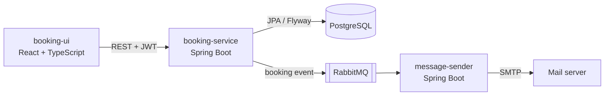

# Office Booking

[](https://github.com/Den-ab/office-booking/actions/workflows/ci.yml)

A web application for booking desks in an office. Employees sign in, pick a free desk and book it for the day; administrators manage office areas and desks. Every booking triggers a confirmation email that is sent asynchronously by a separate microservice through RabbitMQ.

Built as the final project of the OTUS "Spring Framework Developer" course.

## Architecture



- **booking-service** is the REST API: authentication, areas, desks and bookings. When a booking is saved it publishes an event to RabbitMQ instead of sending email itself, so a slow or unavailable mail server never blocks the user.
- **message-sender** consumes those events, renders a FreeMarker template (English and Russian) and sends the email over SMTP.
- **booking-ui** is a single-page React app that talks to the API with a JWT.

## Tech stack

| Area | Technologies |
| --- | --- |
| Backend | Java 17, Spring Boot 3, Spring Web MVC, Spring Data JPA (Hibernate), Bean Validation |
| Security | Spring Security, stateless JWT authentication (jjwt), BCrypt, role-based access (USER / ADMIN) |
| Data | PostgreSQL, Flyway migrations |
| Messaging | RabbitMQ (Spring AMQP), FreeMarker email templates with i18n |
| Frontend | React 19, TypeScript, Vite |
| Infrastructure | Docker, Docker Compose, GitHub Actions |
| Testing | JUnit 5, Mockito, AssertJ, Spring MockMvc, Spring Security Test |

## Features

- Sign-in with email and password; the API issues a JWT and checks it on every request.
- Two roles: users book desks, administrators also manage areas and desks.
- A user cannot book the same desk twice on the same day.
- Booking confirmation email, sent asynchronously through RabbitMQ.
- Validation errors and conflicts come back as structured JSON (HTTP 400 and 409).

## Quick start

Requirements: Docker and Node.js 18+.

```bash
# Backend: PostgreSQL, RabbitMQ, Mailpit and both services
docker compose up --build

# Frontend, in a second terminal
cd booking-ui
npm install
npm run dev
```

| What | Where |
| --- | --- |
| Web UI | http://localhost:5173 |
| REST API | http://localhost:9010 |
| Mailpit inbox (booking emails land here) | http://localhost:8025 |
| RabbitMQ management | http://localhost:15672 (guest / guest) |

Demo accounts:

| Email | Password | Role |
| --- | --- | --- |
| admin@example.com | admin123 | ADMIN |
| user@example.com | user123 | USER |

## REST API

| Method | Path | Description |
| --- | --- | --- |
| POST | `/auth/login` | Sign in, returns a JWT, the user id and the role |
| GET | `/areas` | List areas |
| POST / PUT | `/areas` | Create / update an area |
| DELETE | `/areas/{id}` | Delete an area |
| GET | `/desks` | List desks with their areas |
| POST / PUT | `/desks` | Create / update a desk |
| DELETE | `/desks/{id}` | Delete a desk |
| GET | `/bookings` | List bookings |
| POST | `/bookings` | Book a desk for today |
| DELETE | `/bookings/{id}` | Cancel a booking |

All endpoints except `/auth/login` require the `Authorization: Bearer <token>` header.

## Running the tests

```bash
cd booking-service && mvn test
cd message-sender && mvn test
```

The tests cover booking rules, JWT handling, role-based access to the API, error responses and email template rendering. GitHub Actions runs them, builds the UI and the Docker images on every push.

## Project structure

```
booking-service/   REST API: authentication, areas, desks, bookings
message-sender/    consumes booking events from RabbitMQ and sends emails
booking-ui/        React single-page application
compose.yaml       local stack: PostgreSQL, RabbitMQ, Mailpit and both services
```
